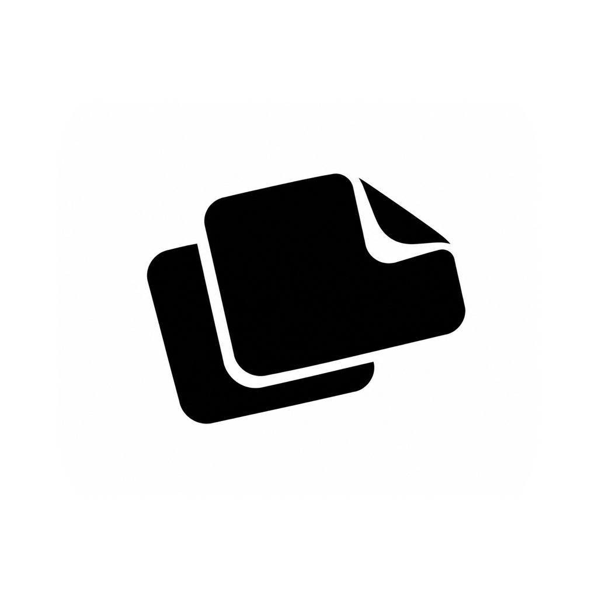

# handypick

**Copy, paste, and capture. A little easier.**

A lightweight macOS menu bar app that keeps everyday actions close at hand.

**English** · [简体中文](README.zh-CN.md)

[Download for Mac](https://github.com/deernova-studio/handy-pick/releases/latest) · macOS 14+ · Apple Silicon

## Shortcuts for copy, paste and capture

- Double-click the middle mouse button to copy in the active app.
- Hold Control and Option and press V twice to paste.
- Hold Control and Option and press S twice to start a screenshot.

Open the menu bar panel and click the gear to customize shortcuts or switch to single-press key combinations. Actions can share a shortcut and use the pointer context to choose between them.

## Small app, useful extras

- **Make screenshots clearer.** Resize the selection, draw lines and circles, or add text.
- **Pick text from pictures.** Open a history image, select words, and copy. Text recognition stays on your Mac.
- **Find what you just copied.** Browse image and text history, preview an item, and copy it again.

Lives quietly in your menu bar. No account needed. Clipboard history stays in memory and clears when the app quits.

## Get started

Open the DMG, drag handypick into Applications, and launch it. Allow Screen Recording and Accessibility when prompted, then try a middle-button double-click.

[Usage & development reference (中文)](docs/reference.zh-CN.md) · [Build from source](apps/handy-pick/README.md)
