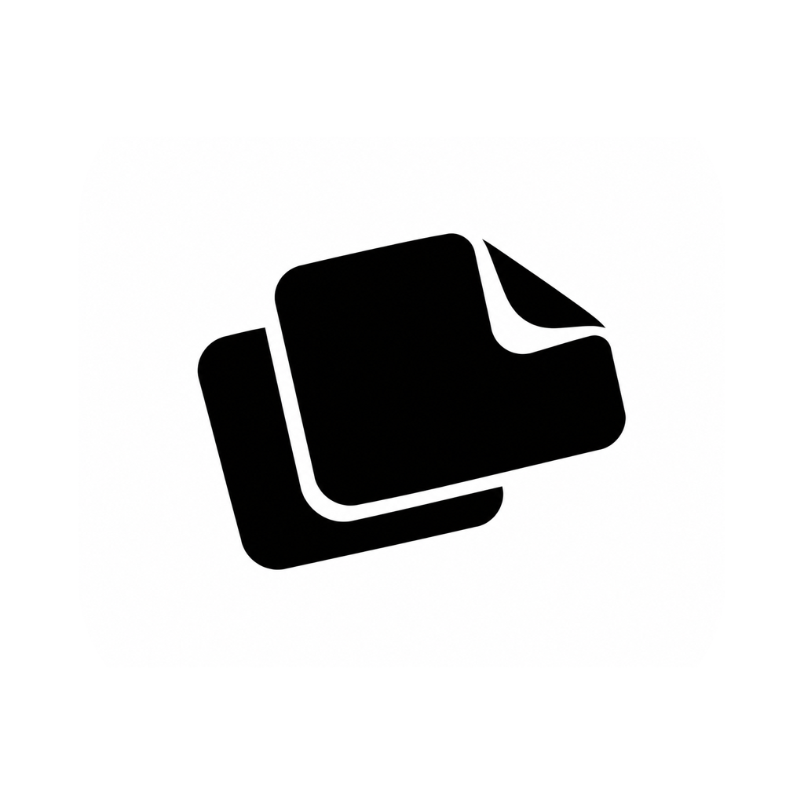

# handypick

**Copy, paste, and capture. A little easier.**

A lightweight macOS menu bar app that keeps everyday actions close at hand.

**English** · [简体中文](README.zh-CN.md)

[Download for Mac](https://github.com/deernova-studio/handy-pick/releases/latest) · macOS 14+ · Apple Silicon

## One gesture, three handy actions

Double-click the middle mouse button:

| Where you point | What happens |
| --- | --- |
| Selected text | Copy the selection |
| A supported input field | Paste your clipboard |
| Elsewhere | Capture part of your screen |

Prefer a keyboard shortcut? Set your own from the menu bar.

## Small app, useful extras

- **Make screenshots clearer.** Resize the selection, draw lines and circles, or add text.
- **Pick text from pictures.** Open a history image, select words, and copy. Text recognition stays on your Mac.
- **Find what you just copied.** Browse image and text history, preview an item, and copy it again.

Lives quietly in your menu bar. No account needed. Clipboard history stays in memory and clears when the app quits.

## Get started

Open the DMG, drag handypick into Applications, and launch it. Allow Screen Recording and Accessibility when prompted, then try a middle-button double-click.

[Usage & development reference (中文)](docs/reference.zh-CN.md) · [Build from source](apps/handy-pick/README.md)
