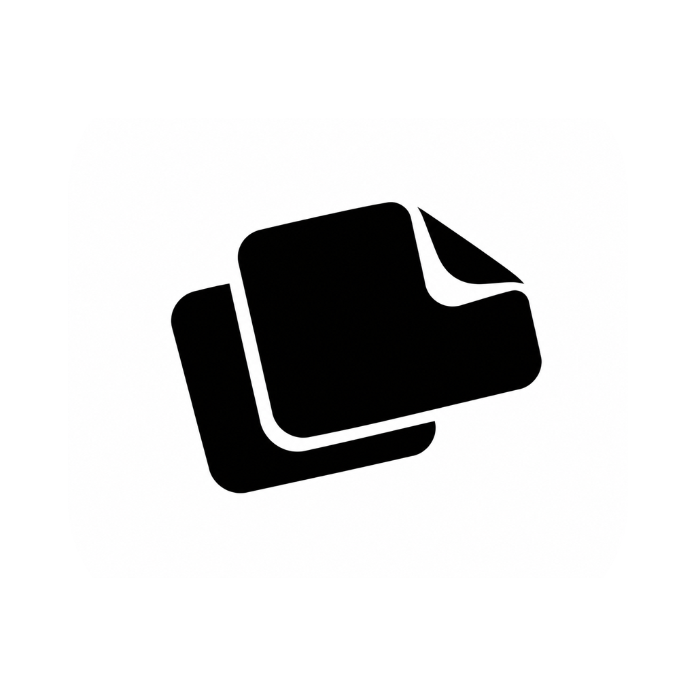

# 随取 · handypick

**复制、粘贴、截图，顺手一点。**

一个轻量的 macOS 菜单栏小工具，让日常操作少一点来回。

[English](README.md) · **简体中文**

[下载 Mac 版](https://github.com/deernova-studio/handy-pick/releases/latest) · macOS 14+ · Apple 芯片

## 一个手势，三件小事

双击鼠标中键：

| 鼠标停在哪里 | 随取帮你做什么 |
| --- | --- |
| 已选中的文字上 | 复制选中文字 |
| 支持的输入框内 | 粘贴剪贴板内容 |
| 其他位置 | 框选截图 |

更习惯键盘？点菜单栏图标，设置自己的快捷键。

## 小巧，也够用

- **截图说得更清楚。** 调整选区、划线、画圈、添加文字。
- **图片里的字，直接选。** 本地 OCR 识别，在图片上拖选文字并复制。
- **刚复制的，随时找。** 按图片、文字查看历史，放大预览，再次复制。

安静待在菜单栏，无需注册账号。剪贴板历史只存内存，退出应用即清空。

## 开始使用

打开 DMG，将随取拖入「应用程序」并启动。按提示开启屏幕录制和辅助功能权限，然后试试双击中键。

[使用与开发参考](docs/reference.zh-CN.md) · [从源码构建](apps/handy-pick/README.md)
